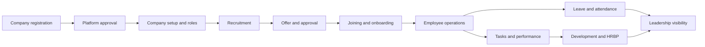

# HR Portal — Product Pitch Brief

**Product:** HR Portal  
**Category:** Multi-tenant HR, people operations and workforce management platform  
**Audience:** Business owners, founders, HR leaders, department managers and prospective customers  
**Baseline:** Main branch, 19 November 2026

## 1. The product in one sentence

HR Portal brings the employee lifecycle and day-to-day people operations into one secure workspace—from hiring and onboarding to attendance, leave, performance, tasks and workforce development.

## 2. The problem

Growing companies often run HR through disconnected spreadsheets, email threads, forms and separate point solutions. The result is fragmented employee information, repeated data entry, unclear ownership, slow approvals and limited visibility for leadership.

Common pain points include:

- Hiring activity, interview feedback and onboarding tasks spread across tools.
- Leave balances and attendance corrections that are difficult to reconcile.
- Managers unsure what needs their attention or approval.
- Performance reviews disconnected from goals and actual work evidence.
- HR teams manually chasing documents, reminders and routine processes.
- Leadership lacking a consistent view of headcount, hiring, performance and people risks.
- Sensitive employee information requiring stronger access boundaries than shared spreadsheets provide.

## 3. The solution

HR Portal provides a company-specific environment with role-based access and connected workflows. Each company is onboarded independently after platform approval, then configures its people, departments, roles and enabled modules.

The platform is not just an employee directory. It connects operational HR processes and routes work to the right person, with auditability and automation built into the workflow.

## 4. Core value proposition

- **One employee lifecycle:** connect recruitment, offers, joining, probation, performance and growth.
- **Less manual follow-up:** approvals, reminders, scheduled checks and workflow automation reduce repetitive coordination.
- **Clear accountability:** employees, managers, HR and approvers see the work relevant to their role.
- **More reliable decisions:** structured criteria, evidence and approval steps replace informal, untraceable decisions.
- **Tenant-aware security:** company data and permissions are enforced by server-side identity and access checks.
- **Practical AI assistance:** AI can help interpret resumes, draft content and answer permitted HR questions without replacing deterministic rules or human approvals.

## 5. Product workflow

## 6. What the platform includes

| Area | Business outcome |
|---|---|
| Multi-tenant workspace and roles | Separate company workspaces with controlled access |
| Home and employee portal | A role-aware place for daily actions, updates and announcements |
| People / Employee 360 | Searchable employee records and a consolidated employment view |
| Leave and attendance | Leave policies, balances, approvals, check-in/out, regularization and reports |
| Talent Acquisition | Requisitions, candidate pipeline, JD library, scoring, interviews and feedback |
| Hiring Automation | Configurable applicant journey, approvals, routing and follow-up |
| Offers and onboarding | Controlled offer approval, candidate response and joining checklists |
| HR Business Partner | Talent review, headcount planning, succession, learning and retention workflows |
| Performance | KPI plans, evidence, check-ins, quarterly reviews and development plans |
| Tasks and projects | Assigned work, review, project boards and reminders |
| Wellbeing | Optional short games and privacy-protected role-relevant team insights |
| Ask HR | Read-only conversational help for permitted employee policy and personal HR questions |
| Platform administration | Company approval and editable public-site content |

## 7. Differentiation

### Connected workflows rather than isolated modules

Hiring, onboarding, people records, performance and task management are designed to share workflow context. For example, an accepted offer can initiate joining; an approved KPI-linked task can become performance evidence; training needs can be surfaced to HRBP.

### Configurable processes with guardrails

Companies can define roles and permissions, configure hiring flows, set leave policies and adapt role skill profiles. Publishing and approval safeguards are designed to catch incomplete or conflicting configurations.

### AI with boundaries

AI assists with resume interpretation, drafting and read-only HR answers. Business rules retain responsibility for scoring, permissions, approval and workflow state. The platform remains usable without an AI key for supported fallback paths.

### Privacy-aware workforce insight

Individual data is permission-gated. Wellbeing participation is consent-based, small groups are suppressed and individual access is logged. Performance and task metrics are not treated as simplistic productivity rankings.

## 8. Who benefits

- **Founders and business owners:** visibility into hiring, workforce plans, budgets and people operations.
- **HR leaders:** a connected operating system for hiring, employee records, leave, attendance, reviews and development.
- **Managers:** clear team approvals, assigned actions, performance evidence and review workflows.
- **Employees:** self-service access to leave, attendance, tasks, policies, personal progress and onboarding actions.

## 9. Example 45-second pitch

“HR Portal brings the core work of people operations into one secure workspace. Companies can manage hiring, interviews, offers and onboarding, then continue into employee records, leave, attendance, tasks and performance. Instead of chasing spreadsheets and email approvals, the platform routes actions to employees, managers, HR and founders with clear permissions and audit trails. Configurable workflows handle repeatable steps, while AI helps with tasks such as resume interpretation and answering employees’ permitted HR questions. The goal is straightforward: less administrative follow-up, clearer accountability and a more connected employee lifecycle.”

## 10. Qualification questions

1. How many employees and legal entities does the company manage?
2. Which HR processes currently rely on spreadsheets or email?
3. Where do hiring and onboarding handoffs break down?
4. How are leave balances, attendance and corrections managed today?
5. How are goals, evidence and performance reviews connected?
6. Which roles need access to individual employee information versus aggregate reporting?
7. Which systems must integrate with the HR platform?
8. What would make a first implementation successful in the first 30–60 days?

## 11. Suggested pilot

Start with one company and a controlled set of users:

- Configure company profile, departments, employees and role permissions.
- Activate one or two priority workflows, such as leave/attendance or recruitment/onboarding.
- Validate employee and manager self-service.
- Confirm notification, scheduled-job and data-import behaviour.
- Review access boundaries, audit records and reporting with HR.
- Measure approval turnaround, manual follow-up effort and process completion.

Expand to performance, HRBP, task management and other modules after the foundational workflows are accepted.

## 12. Claims and implementation boundaries

This brief describes capabilities documented in the inspected main branch. It should not be read as a claim that every optional integration is configured in every customer environment.

Examples of documented boundaries: payroll integration with attendance/leave is not yet complete; WhatsApp reminders and real calendar synchronization are optional or not built; some biometric-dependent attendance reports are unavailable; task recurrence and dependencies are not in the current version. Shared SMTP is currently used across companies. Legal templates and statutory defaults require appropriate professional review.

## 13. Closing message

**HR operations should move forward as one connected process—not as a collection of disconnected follow-ups.**

HR Portal gives growing companies a structured foundation for managing people, work and the employee lifecycle, with security, accountability and practical automation at its core.
