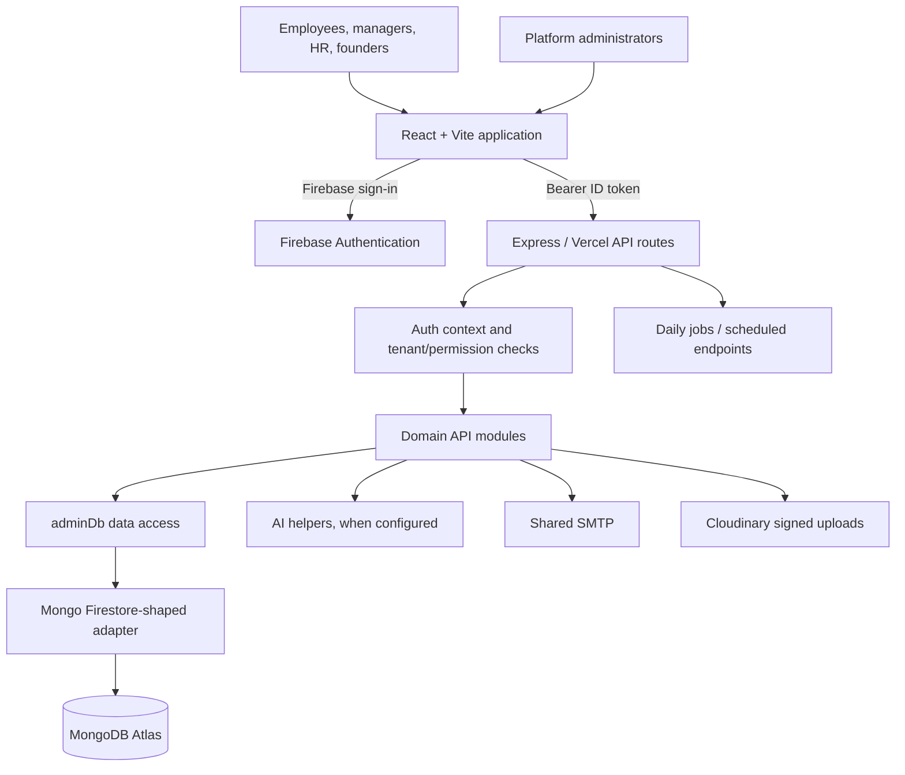

# HR Portal — Technical Architecture Documentation

**Repository:** `amaavigo-crypto/hr-portal-mongodb`  
**Baseline:** `main`, inspected 19 November 2026  
**Product type:** Multi-tenant human-resources and workforce operations platform  
**Status:** As-built technical reference; current behaviour and known limitations are distinguished from future direction.

## 1. Executive overview

HR Portal is a multi-company HR operations platform. Companies register, await platform approval, and then manage their own employees, departments, roles, hiring, onboarding, leave, attendance, performance, tasks and related workflows. The product combines a React web application, server-side API routes, MongoDB-backed application data and Firebase Authentication.

The application is designed around tenant isolation and permission-based access. A company’s users operate within a company context; platform administrators manage company activation and platform-level configuration. The browser does not connect directly to MongoDB.

## 2. Technology stack

| Layer | Current implementation |
|---|---|
| Web UI | React 19, Vite 6, TypeScript |
| Styling / interaction | Tailwind CSS 4, Motion, Lucide React |
| API runtime | Express 4 and Vercel serverless function entry points |
| Application database | MongoDB Node driver 6; MongoDB Atlas supported |
| Authentication | Firebase Authentication (email/password) |
| Server identity | Firebase Admin SDK and signed ID-token custom claims |
| AI | OpenAI-compatible hiring/assistant helpers; Google GenAI dependency also present |
| Email | Nodemailer and shared SMTP account |
| File attachments | Cloudinary for task attachments |
| Documents | docx, docx-preview, pdf-lib, pdfjs-dist, jszip |
| Build | Vite build plus esbuild bundle for the Express server |
| Runtime target | Node.js 22.x |

The package scripts include `npm run dev`, `npm run build`, `npm start`, `npm run lint` and `npm run migrate:mongo`.

## 3. High-level architecture



### Runtime boundaries

- The browser authenticates with Firebase and calls application APIs with its ID token.
- API handlers validate the token, active tenant, company context and required permissions before operating on tenant data.
- Domain modules use `adminDb()`; with `MONGODB_URI` configured this resolves to the Firestore-shaped MongoDB adapter in `api/_lib/mongoFirestore.ts`.
- MongoDB credentials and Firebase service-account credentials remain server-side.
- Scheduled jobs call protected endpoints using `CRON_SECRET` where applicable.

## 4. Tenant lifecycle and identity

### Company lifecycle

1. A company registers with email and password.
2. The company is created in a pending state and cannot access tenant data.
3. A platform administrator reviews and approves the company.
4. The company becomes active and receives the modules enabled for it.
5. Its company administrator onboards employees, departments and roles.

### Identity claims

The server provisions accounts using Firebase Admin and places authorization context in signed token claims:

- `cid`: company/tenant identifier
- `cs`: company status
- `perms`: permission set
- `adm`: administrative context

API routes use verified claims rather than trusting tenant or permission values supplied by the browser. Company-admin permissions are also recognized by server-side authorization helpers. Default role templates include Company Admin, Head HR, HR, Approver/Founder, Department Head and Employee; companies can define additional roles from a permission checklist.

### Isolation requirements

- Every tenant-owned record is scoped by `companyId` (or the authenticated company context).
- API handlers must derive the active tenant from verified identity, not from arbitrary request-body values.
- Server-only collections are not exposed through browser data APIs.
- Sensitive individual views require explicit permissions and, where implemented, audit logging.
- Cross-company access is denied by server-side checks.

## 5. Data architecture

### MongoDB compatibility layer

The application retains Firestore-shaped data access while using MongoDB for persistence. The adapter maps old Firestore collection/document operations to MongoDB collections and documents:

- One MongoDB collection per former Firestore collection.
- Document IDs are stored as MongoDB `_id`.
- Domain modules call `adminDb()` rather than opening their own database connections.
- MongoDB transactions are used on Atlas replica sets. A standalone MongoDB deployment uses a process-local serialized fallback and does not provide the same cross-process transaction guarantees.

### Browser data gateway

The browser cannot connect to MongoDB. Previously browser-readable datasets (including companies, employees, departments, roles, documents, versions, audit logs, acknowledgements, notifications, document suggestions and requisitions) are accessed through `POST /api/tenant/data-*`, implemented in `api/_lib/dataApi.ts`. The gateway applies tenant and permission checks. `src/services/dataStore.ts` preserves the browser-facing service interface.

### Live refresh

MongoDB does not provide the same Firestore browser push behaviour. Open screens re-check approximately every 20 seconds (`POLL_MS`), when the tab regains focus, and after the current user saves data.

### Migration

The repository provides a non-destructive Firestore-to-MongoDB migration:

```bash
npm run migrate:mongo -- --dry-run
npm run migrate:mongo
```

The migration copies collections and does not delete the source data. Run it during a quiet period and verify the result before deploying with `MONGODB_URI`. The single-company-to-multitenant migration script also supports a dry run and prints the company ID used for `HOME_COMPANY_ID`.

## 6. Application domains and modules

The following is the product scope described by the current main-branch README and implementation notes.

### 6.1 Home and employee experience

The Home screen is the signed-in landing page. It includes profile/reporting context, mood check-in, leave calendar, attendance actions, quick links and reports, employees on leave, birthdays and anniversaries, important files, CEO messages, announcements, acknowledgements and login analytics for authorized users. Personal dates are held separately from employee records; colleagues see only limited date information. Mood is presented as company-level counts.

### 6.2 People and Employee 360

Employee 360 provides a searchable, read-only employee record for authorized company roles. It can include employment details, identity documents, personal information, family information and qualifications/certificates. Identity numbers are masked until explicitly revealed. It reuses existing profile endpoints and their server-side permission checks.

### 6.3 Leave and attendance

HR configures leave years, locations, weekly offs, holidays, leave types, policies, accrual/carry-forward rules, shifts, late rules, employee profiles and opening balances. Leave balances are represented as ledger credits and debits, preserving traceability. Accrual and year-end carry-forward/lapse operations are idempotent.

Employees apply for leave and check their balances. Managers approve team requests; a leave type can require manager approval or manager-then-HR approval. Attendance supports web check-in/out, multiple work sessions per day, shift grace periods, late marks, missed-swipe regularization and reports with CSV export. Optional IP allow-listing is supported.

The daily leave job is exposed at `GET /api/leave/cron?key=$CRON_SECRET`. Statutory defaults are starting points, not legal advice. Payroll integration, hourly leave, joining-date-anchored leave years and biometric-device-dependent reports are not currently built.

### 6.4 Talent Acquisition and hiring

The hiring pipeline includes requisitions, budget controls, Position IDs, job-description library, posting tracker, employee referrals, candidate scoring, screening, assessments, interview scheduling, blind interviewer scorecards and candidate-stage management.

- Candidate score is out of 100 with configurable weights for skills, experience, portfolio, communication, stability and salary fit.
- An unassessed criterion remains pending rather than being treated as zero.
- Interview invitations use standard `.ics` attachments; clash warnings and reminders are supported.
- Candidate and hiring data is stored in server-only `hiringItems` records distinguished by `kind`.
- Resume parsing supports text-based PDF/DOCX; scanned-image OCR is not configured for the base pipeline.

### 6.5 Hiring Flow Automation

Each company can configure a hiring flow from applicant arrival through onboarding. Supported steps include resume scoring, screening, skills tests, interviews, human review, approvals, conditional routing, email, wait periods, offers, joining and rejection.

Flows have drafts and published versions. Applicants already in a flow remain on the version they started with. The engine observes existing hiring actions instead of replacing their screens. It validates flows before publishing, prevents loops, supports simulation with a pretend candidate and exposes stuck applicants for HR intervention. Candidate-level flow state and tasks are stored in the hiring data model.

### 6.6 Offers, onboarding and talent cycles

Offers support compensation-band checks, founder approval/counter, template-generated offer packs and candidate responses through private links. Acceptance starts onboarding. Joining workflows track documents, emergency contacts, welcome kits, IT setup and company assets.

Probation reviews support 30/60/90-day checkpoints. OKRs can be set at company, team and individual levels. Promotion approvals follow manager → HR → founder; applying a promotion changes designation, while salary revision is handled separately in Payroll.

### 6.7 HR Business Partner

The HRBP toolkit covers employee-to-business mapping, org structure, approved headcount and resource planning, quarterly talent review/9-box, KPI governance, performance improvement plans, anonymous pulse surveys, recognition, wellness, training needs, learning paths, certificate tracking, retention and succession planning, and a leadership dashboard. Survey results are hidden below the documented minimum response threshold.

### 6.8 Performance Management

Performance uses three dimensions: Results/KPIs (60%), Behaviour (25%) and SOP compliance (15%). Ratings are 1–5 or “Not observed”; unobserved items are excluded rather than scored as zero. A critical SOP non-compliance cannot be averaged away and requires HR review.

The cycle includes HR setup, plan creation, manager target setting, HR approval, employee acknowledgement, evidence capture, monthly check-ins, quarterly reviews, employee acknowledgement/disagreement and development/improvement/recognition plans. Rules prevent self-approval and conflicts of interest. Shared reviews are changed only through audited amendments. AI may draft language from recorded work but does not assign ratings.

### 6.9 Task Management

Tasks provide My Tasks, Boards, Dashboard and Projects. Assignment follows manager/reporting relationships and explicit task-management permissions. Review-required tasks can only be approved by the designated reviewer; nobody approves their own work. KPI-linked tasks require review and can become Performance evidence after approval. Dashboards intentionally avoid individual “most tasks closed” rankings.

Attachments use signed Cloudinary uploads and short-lived access links. Daily reminders are idempotent. Recurring tasks, dependencies, custom project statuses and separate sub-task records are not in the current version.

### 6.10 Wellbeing

Wellbeing Phase 1 contains Fruit Catch, Echo Beats and Fraud Hunter. Participation is consent-based; people may opt out and still play without recording, or delete their recorded data. Players see points, streaks and personal bests, not skill scores. The server issues a seed and replays the submitted interaction to calculate scores and skills.

HR team views suppress groups below five people; skill averages require the documented minimum participation. Individual views require `wellbeing.view_individual`, show only role-relevant skills after sufficient plays, and are audited. The module is intended for development and team planning, not pay, promotion or discipline.

### 6.11 Ask HR assistant

Ask HR is a read-only assistant for a user's own leave, holidays, notice period, payslips and published policies they are permitted to read. Its tools run through existing application routers using the caller's access context. Usage is limited per person and counted against the AI monthly allowance.

### 6.12 Landing site and platform administration

Platform administrators can edit public-site wording, navigation, FAQs, calls to action and SEO/share metadata. Defaults live in `shared/landingContent.ts`; saved differences are stored in `landingContent`. Saves and undo operations are restricted to platform administrators and audited. The Node server renders page text and metadata for search engines and serves sitemap/robots files.

## 7. API and serverless topology

The application groups endpoints into a small number of Vercel function entry points to respect the Hobby function limit. The README documents 11 function groups: catch-all, apply webhook, assistant, email, HRBP, leave, onboarding, performance, recruitment, tasks and tenant.

Domain actions are routed inside shared functions. Hiring actions are routed through `api/_lib/hiringRouter.ts`; new hiring capabilities should be added as actions there rather than creating extra API function files. Wellbeing and Home share the leave function. The README notes a 12-function plan limit and documents the current count as 11.

## 8. Automation and scheduled work

Scheduled operations include leave accrual/carry-forward, hiring reminders and expiry, probation and quarterly reminders, interview reminders, screening-link sweeps, performance-cycle checks, task reminders and module-specific daily processing. Protected jobs use `CRON_SECRET`. The Vercel Hobby cron allowance is constrained; some jobs are intended to be invoked through an external scheduler such as cronjob.org rather than adding more Vercel cron definitions.

Idempotency is a recurring design requirement: repeating a daily job should not duplicate accrual, state transitions, reminders or other side effects.

## 9. AI architecture and safeguards

AI is an assistive layer, not the source of truth for business rules:

- Candidate scoring uses deterministic criteria and configured weights; AI provides deeper resume interpretation and recommendations.
- AI can draft job descriptions, candidate communications and summaries.
- Ask HR is read-only and invokes existing tools under the user's permissions.
- Performance AI drafts language only; it does not generate ratings or make final decisions.
- Wellbeing scores are computed by deterministic server replay, not by AI or client-submitted score values.
- If an AI key is absent, documented features fall back to rules or remain usable without AI where supported.

Environment variables include `OPENAI_API_KEY`, model selectors and per-company usage controls. Never commit provider keys.

## 10. Security, privacy and audit

Key controls documented in the repository:

- Firebase ID-token verification and active-tenant enforcement.
- Tenant ID and permissions taken from signed claims.
- Server-only collections and server-mediated browser data access.
- Permission checks at API boundaries.
- Individual wellbeing access logging and opt-in/opt-out controls.
- Masking of identity-document numbers until revealed.
- Anonymous survey minimum-group thresholds.
- Short-lived signed Cloudinary access links for task files.
- Audit trails for sensitive workflows and changes.
- No self-approval for performance targets/reviews or tasks.
- AI must not infer or decide protected personal characteristics; documented performance rules discard and log inappropriate personality, motive or health content.

## 11. External services and configuration

| Variable / service | Purpose |
|---|---|
| `MONGODB_URI`, `MONGODB_DB` | MongoDB connection and optional database name |
| `FIREBASE_SERVICE_ACCOUNT_JSON` | Server-side Firebase Admin credentials |
| Firebase web config | Browser authentication setup |
| `APP_URL`, `APP_BASE_URL` | Public canonical URL and emailed candidate links |
| `CRON_SECRET` | Protect scheduled endpoints |
| `OPENAI_API_KEY` | AI-assisted workflows |
| `OPENAI_HIRING_MODEL`, `OPENAI_ASSISTANT_MODEL` | Optional model selection |
| `AI_MONTHLY_CALLS`, `ASSISTANT_DAILY_LIMIT` | AI usage controls |
| `MS_TENANT_ID`, `MS_CLIENT_ID`, `MS_CLIENT_SECRET`, `MS_ORGANIZER_UPN` | Optional Microsoft Teams meeting integration |
| `WHATSAPP_TOKEN`, `WHATSAPP_PHONE_ID` | Optional WhatsApp reminders |
| `CLOUDINARY_CLOUD_NAME`, `CLOUDINARY_API_KEY`, `CLOUDINARY_API_SECRET` | Task attachment storage |

Email currently uses one shared SMTP account across companies. Microsoft Teams meeting links and WhatsApp reminders activate when configured; Google Meet and ClickUp are manual in the documented implementation.

## 12. Build, test and deployment

Typical local workflow:

```bash
npm install
npm run dev
npm run lint
npm run build
npm start
```

Tests are TypeScript scripts invoked with `npx tsx tests/<name>.test.ts`. The README documents coverage for the Mongo adapter/data gateway, landing content, performance, tasks, hiring flows, skill tests, wellbeing, assistant and anomaly/flags logic.

For MongoDB-backed tests:

```bash
TEST_DB=mongo npx tsx tests/<name>.test.ts
```

Deployment requires the Firebase configuration and server credentials plus the intended MongoDB connection. Confirm environment variables in the target hosting environment before switching production traffic. The migration scripts are non-destructive; take a backup and verify counts and representative tenant records before and after migration.

## 13. Known limitations and operational caveats

The following are explicitly documented as not yet built or constrained:

- Payroll integration with attendance/leave is not yet implemented.
- Hourly leave and joining-date-anchored leave years are not built.
- Some attendance reports require biometric-device data and are not available.
- Help Desk, Survey and dependent files are not built in the Home scope described by README.
- Scanned-image OCR is not configured for the base hiring pipeline (separate later AI resume-reading capability is described in README).
- WhatsApp interview reminders and true Google/Microsoft calendar sync are not built; standard `.ics` invitations are used.
- Task recurrence, dependencies, custom statuses and separate sub-task entities are not built.
- Shared SMTP is used across tenants.
- Some legacy onboarding records require company-ID backfill.
- Some screens/document stamps still contain “Amaavigo”.
- Legacy uploaded-file links need migration handling before disabling `LEGACY_OPEN_STORAGE`.
- Existing company roles may need newly introduced permissions granted manually.
- The Firestore-shaped adapter is a compatibility layer; transaction guarantees differ on standalone MongoDB.
- Statutory leave defaults must be reviewed by a qualified local labour-law advisor.

## 14. Architecture principles

1. Tenant isolation is enforced on the server.
2. The browser never receives database credentials or direct MongoDB access.
3. Domain logic and authorization remain server-side.
4. Sensitive actions are permission-gated and auditable.
5. Repeated automation is idempotent.
6. AI assists with language and analysis; deterministic rules own scores, approvals and state transitions.
7. New features should reuse existing function groups where practical to stay within hosting limits.
8. Product claims must distinguish implemented capabilities from planned work.

## 15. Source-of-truth files

| Concern | Main implementation locations |
|---|---|
| MongoDB adapter | `api/_lib/mongoFirestore.ts` |
| Browser data gateway | `api/_lib/dataApi.ts` |
| Browser data service | `src/services/dataStore.ts` |
| Hiring routing | `api/_lib/hiringRouter.ts` |
| HRBP | `api/_lib/hrbpApi.ts`, `shared/hrbpEngine.ts` |
| Performance | `api/_lib` performance actions, `shared` performance rules |
| Tasks | `api/_lib/taskCore.ts`, `api/_lib/taskApi.ts`, `shared/taskEngine.ts` |
| Wellbeing | `api/_lib/wellbeingApi.ts`, `shared/wellbeingEngine.ts` |
| Ask HR | `api/_lib/assistantApi.ts`, `shared/assistantEngine.ts` |
| Landing content | `shared/landingContent.ts`, `src/landing/content.tsx` |
| Leave and attendance | `api/_lib/leaveCore.ts`, `src/components/leave/` |

---
*Prepared from the repository's main-branch README, package manifest and recent main-branch implementation notes. Verify source files and deployment configuration before using this document as an operational runbook.*
